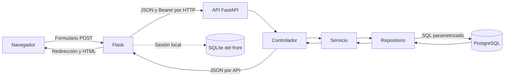

# Guía de archivos y funcionamiento para la sustentación

Esta guía ayuda a explicar el proyecto con sus archivos abiertos. Está basada en el código de `v3-desarrollo` revisado desde `90aaad8`, el 9 de noviembre de 2026. Los resultados citados pertenecen a las verificaciones registradas: escribir esta guía no vuelve a ejecutar esas pruebas ni certifica una revisión humana.

Una presentación inicial posible:

> «El proyecto administra información de investigación: áreas de conocimiento, docentes, grupos, semilleros y sus relaciones. Tiene una pantalla en Flask, una API en FastAPI y una base PostgreSQL. Se desarrolló por versiones: primero un CRUD de referencia, después relaciones entre tablas y luego autenticación y permisos».

CRUD significa **crear, consultar, actualizar y retirar registros**. Aquí retirar normalmente significa dejar inactiva la fila, conservándola.

## 1. Mapa del proyecto: dónde buscar cada cosa

Las rutas de los enlaces parten de este documento. Los comandos se ejecutan desde la raíz del repositorio.

| Carpeta o archivo | Para qué sirve y por qué existe |
|---|---|
| [api_investigacion/](../api_investigacion/) | Servicio que recibe HTTP, aplica reglas y consulta PostgreSQL. Es independiente de las pantallas. |
| [controllers/](../api_investigacion/controllers/) | Puerta de entrada de la API: relaciona rutas y verbos HTTP con operaciones. |
| [models/](../api_investigacion/models/) | Pydantic declara campos, tipos y límites de las peticiones. No son modelos de un ORM. |
| [servicios/](../api_investigacion/servicios/) | Reglas como rechazar una actualización vacía o un retiro con dependientes. Incluye los ensambladores. |
| [repositorios/](../api_investigacion/repositorios/) | SQL escrito a mano y conexión PostgreSQL. `abstracciones/` describe lo que el servicio necesita del almacenamiento. |
| [seguridad/](../api_investigacion/seguridad/) y [comandos/](../api_investigacion/comandos/) | Adaptadores de hash/JWT y comando local para crear el primer administrador sin registro público. |
| [pruebas de API](../api_investigacion/pruebas/) | Comprueban reglas, HTTP, autenticación, migración y regresiones. Algunas usan memoria y otras PostgreSQL aislado. |
| [front_flask/](../front_flask/) | Vistas y cliente HTTP. Obtiene los datos del módulo por la API, sin consultar sus tablas directamente. |
| [templates/](../front_flask/templates/) y [static/](../front_flask/static/) | Jinja produce el HTML; `static` conserva CSS y logos. Permiten cambiar presentación sin tocar SQL. |
| [pruebas del front](../front_flask/pruebas/) | Comprueban sesiones, formularios y permisos de Flask; también participan en un recorrido integrado. |
| [db/](../db/) | `init.sql` crea la base inicial; [migraciones/](../db/migraciones/) adapta un esquema existente; [opcionales/](../db/opcionales/) separa cargas oficiales y demo. Son tareas distintas. |
| [docs/](./) y [Spec Kit](spec_kit/README.md) | Requisitos, decisiones, contratos y evidencia: permiten explicar por qué se hizo algo y qué falta. |
| [scripts/](../scripts/) | Automatiza configuración externa y verificación v3 para evitar repetir pasos manuales. |
| [postman/](../postman/) y [pruebas_humo/](../pruebas_humo/) | Materiales históricos de prueba del ejemplo; no asumir que incluyen Bearer y CSRF de v3. |
| [ProyectosDeAula/](../ProyectosDeAula/) | Material del curso y fuentes. El módulo original es más amplio que el recorte local v1. |
| [marca/](../marca/) y [manual](../MANUAL_DE_MARCA.md) | Recursos y reglas de Universidad Monte Verde. Su existencia no certifica la revisión visual. |
| [docker-compose.yml](../docker-compose.yml) | Arranque predeterminado v2; no es el arranque autenticado v3. |
| [docker-compose.v3.yml](../docker-compose.v3.yml) | PostgreSQL, migración previa, API y front v3, separados de los volúmenes v2. |

Entradas reales: [main.py](../api_investigacion/main.py) conserva API v2; [main_v3.py](../api_investigacion/main_v3.py) añade seguridad. En Flask, [app.py](../front_flask/app.py) contiene vistas anteriores y [app_v3.py](../front_flask/app_v3.py) integra la sesión y permisos v3. V3 reutiliza y protege las rutas previas.

## 2. Spec Kit: qué explica cada documento

**La especificación dice lo esperado; la verificación registra lo comprobado.** Una casilla o un archivo no reemplazan evidencia. Los nombres numerados se repiten por versión; los enlaces siguientes usan v3 como ejemplo. El [índice](spec_kit/README.md) permite abrir v1/v2.

| Documento | Propósito | Qué contiene aquí | Cómo explicarlo oralmente |
|---|---|---|---|
| [1_constitution.md](spec_kit/1_constitution.md) | Fijar reglas comunes | Capas, SQL, borrado lógico, secretos e idioma | «Son las reglas generales; sus cambios deben justificarse». |
| [0_mapa_versiones.md](spec_kit/versiones/0_mapa_versiones.md) | Ubicar el crecimiento | Tablas y funciones de cada versión; conserva estados históricos | «Muestra el camino, no prueba que las versiones estén aceptadas». |
| [2_spec.md](spec_kit/versiones/v3_autenticacion/2_spec.md) | Definir qué construir | Alcance, permisos, exclusiones y pendientes | «Dice qué problema resolvemos y qué queda fuera». |
| [3_plan.md](spec_kit/versiones/v3_autenticacion/3_plan.md) | Organizar cómo hacerlo | Integración de capas, front y verificación | «Es la estrategia para convertir requisitos en código». |
| [4_research.md](spec_kit/versiones/v3_autenticacion/4_research.md) | Justificar elecciones | Alternativas, restricciones y consecuencias | «Explica por qué elegimos esta solución». |
| [5_data_model.md](spec_kit/versiones/v3_autenticacion/5_data_model.md) | Describir los datos | Tablas, claves, relaciones y columnas nuevas | «Aclara qué guardamos y cómo se relaciona». |
| [6_contracts.md](spec_kit/versiones/v3_autenticacion/6_contracts.md) | Acordar HTTP | Rutas, verbos, JSON, respuestas y errores | «Es el acuerdo entre pantalla y API». |
| [7_quickstart.md](spec_kit/versiones/v3_autenticacion/7_quickstart.md) | Facilitar arranque/pruebas | Configuración, Docker, migración y bootstrap | «Otra persona puede preparar el entorno sin adivinar pasos». |
| [8_tasks.md](spec_kit/versiones/v3_autenticacion/8_tasks.md) | Seguir el trabajo | Tareas y referencias a evidencia | «Divide el plan en trabajo comprobable». |
| [9_checklist.md](spec_kit/versiones/v3_autenticacion/9_checklist.md) | Revisar antes de aceptar | Criterios y pendientes humanos; en v1 revisa la especificación antes de programar | «Ayuda a revisar; una firma real no se inventa». |
| [GUIA_IA3.md](spec_kit/versiones/v3_autenticacion/GUIA_IA3.md) | Registrar ayuda de IA | Solicitudes, decisiones, resultados y límites | «Explica la ayuda recibida; nosotros debemos comprender el resultado». |
| [VERIFICACION_V3.md](spec_kit/versiones/v3_autenticacion/VERIFICACION_V3.md) | Conservar evidencia | Comandos, resultados y límites, con historia separada | «Aquí mostramos qué se ejecutó y qué no podemos afirmar». |

La evidencia v2 está en [VERIFICACION_V2.md](../VERIFICACION_V2.md), en la raíz. Los documentos históricos explican la evolución; algunos comandos/estados antiguos no describen el arranque actual. Para ejecutar v3, usar su quickstart.

## 3. Diferencias entre versiones y estado real

| Versión | Implementado en esta rama | Verificado según registros | Pendiente |
|---|---|---|---|
| **V1 local** | CRUD/pantalla de `area_conocimiento`, PUT/PATCH, código textual y retiro lógico; patrón de capas | Servicio con repositorio falso, catálogo consultado y regresión HTTP de crear/cambiar/consultar/retirar bajo v3 | Aceptación humana, revisión documental y medición del listado menor de un segundo. La prueba final no repite todos los criterios HTTP originales. |
| **V2** | Diez CRUD con FK: docente, grupo, semillero y siete relaciones; catálogos GET para selectores | Humo histórico PostgreSQL, 12 casos en memoria, regresión HTTP con admin; manual histórico parcial de `aa_linea` y `ods_linea` | Revisión visual completa, decisiones y firmas. Aportes de `ac_linea` presentes en referencias locales v2 aún no integrados en este código v3. |
| **V3** | JWT, Argon2id, roles, sesión, logout global, CRUD administrativo, API/front protegidos, CSRF y migración | 37 casos más migración/capas; matriz de 92 operaciones y un recorrido integrado Flask/API/PostgreSQL | Bootstrap humano, navegador, vencimiento/botón atrás, datos de demostración, revisión del equipo y aceptación. No hay cierre formal. |

El [módulo original](../ProyectosDeAula/docs/modulo_investigacion.md) exige **seis CRUD sin FK en v1** y **dieciséis en v2**. La [spec local v1](spec_kit/versiones/v1_area_conocimiento/2_spec.md) recorta el ejemplo a una tabla. Aquí ODS, área de aplicación, universidad y línea tienen consultas auxiliares; `termino_clave` no tiene CRUD. No afirmar que están completos los dieciséis CRUD originales.

Los datos tampoco son todos iguales:

- [init.sql](../db/init.sql): 218 áreas, 17 ODS y 21 áreas de aplicación de referencia.
- [universidades_oficiales_v2.sql](../db/opcionales/universidades_oficiales_v2.sql): seis universidades de la fuente; no se cargan automáticamente en compose v3.
- [demo_v2.sql](../db/opcionales/demo_v2.sql): diez filas ficticias marcadas DEMO V2 para disponer de padres de práctica; no son datos oficiales ni todas las relaciones de una demostración.

La revisión del 9 de noviembre observó universidades/líneas vacías en la base principal v3, aunque había cargas registradas en v2. Dos volúmenes no comparten datos por tener las mismas tablas. Preparar los padres antes de prometer el recorrido de relaciones.

V2 sigue abierta. La ratificación formal de enmiendas y las firmas siguen pendientes. Esta guía no cambia esos acuerdos ni añade registro público, recuperación por correo o funciones v4.

## 4. Capas del código: qué hace cada pieza

La pantalla y la API son procesos distintos. Dentro de la API se separan recibir HTTP, aplicar reglas y ejecutar SQL.

| Elemento | Archivo real para abrir | Responsabilidad y razón de existir | Frase para exponer |
|---|---|---|---|
| Vista Flask | [app.py](../front_flask/app.py), `editar_area_conocimiento` | Lee formulario, pide la operación al cliente HTTP y elige pantalla/aviso | «Recoge lo que hizo la persona y prepara la pantalla». |
| Cliente HTTP | [cliente_api.py](../front_flask/cliente_api.py), `actualizar_area_conocimiento` y `_llamar` | Envía JSON, añade Bearer en contexto v3 y convierte respuestas en datos/avisos | «Es el intermediario entre pantalla y API». |
| Modelo de petición | [models/area_conocimiento.py](../api_investigacion/models/area_conocimiento.py) | Pydantic comprueba campos/tipos/longitudes. PUT y PATCH tienen modelos distintos | «Revisa que los datos tengan la forma declarada». |
| Controlador | [area_conocimiento_controller.py](../api_investigacion/controllers/area_conocimiento_controller.py), `actualizar` | Conecta PATCH con el servicio y traduce resultados/excepciones a JSON y códigos HTTP | «Recibe la solicitud y traduce su resultado para el cliente». |
| Servicio | [servicio_area_conocimiento.py](../api_investigacion/servicios/servicio_area_conocimiento.py) | Rechaza ID vacío, actualización vacía o retiro con dependientes. No escribe SQL ni decide HTTP | «Aplica las reglas de la operación». |
| Interfaz del servicio | [i_servicio_area_conocimiento.py](../api_investigacion/servicios/abstracciones/i_servicio_area_conocimiento.py) | Declara con `Protocol` las capacidades esperadas, sin fijar clase concreta | «Es la lista de operaciones que puede pedir el controlador». |
| Interfaz del repositorio | [i_repositorio_area_conocimiento.py](../api_investigacion/repositorios/abstracciones/i_repositorio_area_conocimiento.py) | Permite un repositorio PostgreSQL o falso con los mismos métodos | «El servicio pide guardar o buscar sin depender del motor». |
| Repositorio | [repositorio_area_conocimiento_postgresql.py](../api_investigacion/repositorios/repositorio_area_conocimiento_postgresql.py) | Contiene SQL parametrizado y devuelve datos/filas afectadas. SQLAlchemy ejecuta SQL; no mapea entidades con ORM | «Es la pieza que conoce cómo leer y escribir en PostgreSQL». |
| Conexión/transacción | [conexion_postgresql.py](../api_investigacion/repositorios/conexion_postgresql.py) | Agrupa acceso a BD; confirma al terminar correctamente o revierte ante excepción | «Evita confirmar una operación a medias». |
| Ensamblador | [ensamblador.py](../api_investigacion/servicios/ensamblador.py), `crear_servicio_area_conocimiento` | Construye servicio y repositorio concreto con configuración del entorno; concentra esa elección | «Conecta las piezas: decide qué implementación recibe cada interfaz». |

Una interfaz aquí es un `Protocol` de Python, no otra API HTTP. El falso de [prueba_capas.py](../api_investigacion/pruebas/prueba_capas.py) permite comprobar el servicio sin PostgreSQL.

Seguridad conserva la separación mediante [servicio_seguridad.py](../api_investigacion/servicios/servicio_seguridad.py), [su interfaz](../api_investigacion/servicios/abstracciones/i_servicio_seguridad.py), [repositorio de seguridad](../api_investigacion/repositorios/repositorio_seguridad_postgresql.py) y [ensamblador_seguridad.py](../api_investigacion/servicios/ensamblador_seguridad.py). Las comprobaciones que necesitan atomicidad se realizan dentro de la transacción de persistencia.

## 5. Recorrido real: «Guardar solo lo que cambié» en un área

La operación existe. Usaremos el código **ilustrativo** `EXP01`; no se afirma que esté cargado. Para demostrarla se necesita una ficha de práctica creada previamente por administrador. No alterar un catálogo oficial para improvisar.



1. **Abrir la dirección de la ficha.** El navegador pide GET `/areas-de-conocimiento/EXP01/editar`, cuya vista es `editar_area_conocimiento` de [app.py](../front_flask/app.py). Antes de ejecutar esa vista se comprueba la sesión.
2. **Comprobar la sesión antes de la vista.** En v3, `proteger_front` de [app_v3.py](../front_flask/app_v3.py) recupera el JWT del servidor, consulta `/api/sesion` y exige administrador para editar. Con sesión válida, la vista GET pide la ficha a la API y renderiza [formulario.html](../front_flask/templates/areas_conocimiento/formulario.html); si no existe, informa y vuelve al listado. Cuando después llegue el POST, también se compara el `csrf_token` del formulario con el de la sesión.
3. **Enviar el formulario.** El navegador manda POST a Flask, con `verbo=parcial`. `_cuerpo_parcial()` incluye campos no vacíos. **No calcula qué valores cambiaron automáticamente**: si otros siguen llenos, también viajan. Para explicar un PATCH de una sola propiedad, dejar vacíos los otros campos de la ficha de práctica.
4. **Llamar a la API.** `cliente_api.actualizar_area_conocimiento` envía `PATCH /api/area_conocimiento/EXP01`. Para cambiar solo disciplina, el JSON es `{"disciplina":"Ejemplo de exposición"}`. `_llamar` agrega Bearer en el servidor; no coloca el JWT en el HTML. El cliente también adapta `gran_area` a `granArea` cuando corresponde.
5. **Autorizar la escritura.** El middleware de [main_v3.py](../api_investigacion/main_v3.py) valida de nuevo credencial y roles persistidos antes de ejecutar la operación. Una llamada directa de consulta tampoco puede escribir.
6. **Validar forma.** `AreaConocimientoActualizar` en [models/area_conocimiento.py](../api_investigacion/models/area_conocimiento.py) permite campos parciales y limita longitudes. Una entrada incompatible produce 422 antes del método de negocio.
7. **Obtener servicio.** El controlador `actualizar` llama al ensamblador. Este conecta `ServicioAreaConocimiento` con `RepositorioAreaConocimientoPostgreSQL` y reutiliza la instancia.
8. **Aplicar regla.** El servicio limpia el ID y rechaza un diccionario vacío. Llama a la interfaz de repositorio; cero filas afectadas produce una excepción de registro no encontrado.
9. **Ejecutar SQL.** El repositorio compone las columnas validadas y envía sus valores separados. Para este caso, la consulta equivale a:

   ```sql
   UPDATE area_conocimiento
   SET disciplina = :disciplina
   WHERE id = :pk_id AND activo = TRUE;
   ```

   Los parámetros `:disciplina` y `:pk_id` no se sustituyen concatenando texto del usuario al SQL. La transacción de [conexion_postgresql.py](../api_investigacion/repositorios/conexion_postgresql.py) confirma si termina bien.
10. **Regresar.** El repositorio devuelve filas afectadas; el servicio devuelve resultado; el controlador responde 200 con mensaje y `filasAfectadas`. El cliente convierte la respuesta en `(ok, errores)`. Flask muestra aviso y redirige al listado, que hace otro GET a la API para mostrar el cambio.

El botón **«Guardar la ficha completa»** usa PUT: otro modelo exige los tres campos. Falta uno obligatorio: 422. En PATCH, no enviar un campo significa conservarlo; no enviar ningún campo de negocio produce 400. El navegador envía POST a Flask en ambos casos: Flask decide cuál verbo HTTP usar con la API.

## 6. Login, JWT, roles, sesiones y logout reales

### Login y contraseña

[POST /api/login](../api_investigacion/controllers/autenticacion_controller.py) recibe usuario/contraseña. [ServicioAutenticacion](../api_investigacion/servicios/servicio_autenticacion.py) busca la cuenta, verifica actividad y delega la comprobación de contraseña a [ClavesArgon2](../api_investigacion/seguridad/adaptadores.py), que usa pwdlib con Argon2id.

Un **hash** permite verificar la contraseña sin guardarla en texto. No se recupera la contraseña descifrando su hash. Contraseña incorrecta y cuenta inexistente/inactiva dan error público genérico. Cuenta válida sin rol efectivo permitido: 403.

El primer administrador se crea con [crear_administrador.py](../api_investigacion/comandos/crear_administrador.py), con entrada oculta y confirmación. Crea roles/cuenta/asignación en transacción y rechaza cuentas o conflictos existentes. No es registro público ni recuperación de acceso.

### JWT firmado y permisos

El JWT contiene `sub` (ID), versión de sesión, emisión (`iat`), vencimiento (`exp`), emisor (`iss`) y destinatario (`aud`). **Firma no significa cifrado**: no debe contener contraseñas ni secretos.

[TokensJWT](../api_investigacion/seguridad/adaptadores.py) usa PyJWT, permite HS256 y valida firma, claims y tiempo. Duración predeterminada: 30 minutos, configurable mediante `JWT_MINUTOS`; no hay refresh ni renovación automática. El secreto procede del entorno y no se muestra en la sustentación.

**Autenticación** comprueba identidad vigente; **autorización** decide si puede ejecutar la operación. [El repositorio de autenticación](../api_investigacion/repositorios/repositorio_autenticacion_postgresql.py) lee cuenta, versión, roles y asignaciones activos en PostgreSQL por solicitud. Los permisos no se aceptan por aparecer en un token.

| Identidad | Investigación | Administración de seguridad |
|---|---|---|
| Administrador efectivo | Lectura/escritura | Usuarios, roles y asignaciones |
| Consulta efectiva | Solo lectura | Denegada |
| Cuenta válida sin esos roles efectivos | Denegada: 403 | Denegada: 403 |
| Sin token, inválido/vencido/revocado o cuenta inactiva | 401 | 401 |

Otros roles creados no obtienen permisos automáticamente: la política reconoce `administrador` y `consulta`. [main_v3.py](../api_investigacion/main_v3.py) protege investigación y seguridad. Login, diagnóstico y documentación son públicos; sesión/logout validan su propia credencial. OpenAPI declara Bearer para que Swagger lo envíe.

El menú y las URL de Flask también se restringen, pero la API conserva el control definitivo. Ocultar botones no impide construir una petición por fuera de la pantalla.

### Sesión del navegador y CSRF

| Elemento | Dónde está | Para qué sirve |
|---|---|---|
| Cookie Flask firmada | Navegador | Guarda identificador opaco `sid`, CSRF y avisos; no JWT. La firma detecta cambios, no cifra su contenido |
| Sesión local | [SQLite del servidor front](../front_flask/sesiones_servidor.py), volumen `sesiones-v3` | Relaciona el identificador aleatorio con JWT y vencimiento; busca por resumen SHA-256 de ese identificador |
| Vigencia de la API | PostgreSQL: `usuario.version_sesion`, actividad y roles | Revoca credenciales y aplica permisos aunque el navegador conserve una cookie antigua |

SQLite solo guarda sesiones del front. Investigación permanece en PostgreSQL y Flask la consulta por HTTP. No hay JWT en localStorage ni campos HTML. Cookies: HttpOnly y SameSite=Lax; Secure se configura para HTTPS y está desactivado en el HTTP local.

CSRF es un valor aleatorio vinculado a la sesión que también viaja en el formulario. [app_v3.py](../front_flask/app_v3.py) lo compara antes de aceptar POST, incluido login/logout: poseer una cookie no basta para enviar un formulario válido. Al entrar se rotan identificador y CSRF. Usar una pantalla no amplía el vencimiento.

### Logout y administración

`POST /api/logout` incrementa atómicamente `version_sesion`. Si el token tiene versión 4 y la base pasa a 5, los tokens de versión 4 dejan de servir. Invalida **todas las sesiones anteriores de esa cuenta**, incluso después de reiniciar API. Borrar solo la cookie no hace esto.

Flask solicita logout a API y limpia su sesión local al confirmar el resultado. Si API no responde, informa y permite reintentar sin afirmar revocación. Una identidad vigente que perdió roles aún puede pedir logout propio a la API.

[El repositorio de seguridad](../api_investigacion/repositorios/repositorio_seguridad_postgresql.py) también incrementa versión al cambiar clave o retirar cuenta. El caso específico «token vigente → DELETE administrativo → 401» sigue pendiente: la prueba registrada invalida antes el token por cambio de clave. No confundir comportamiento implementado con cobertura de todos sus casos.

Las bajas son lógicas. Editar una asignación retira el par anterior y crea otro en la misma transacción, sin reactivar pares retirados. Las mutaciones bloquean las tres tablas y comprueban administradores efectivos; si el estado final deja cero, hacen rollback. Se probó retiro concurrente; no significa comprobar todas las carreras posibles.

Para explicar errores: 401 pide autenticación; 403 es falta de permiso; 422 es cuerpo incompatible; 400 depende de la regla; 404 es registro ausente/inactivo; 409 es conflicto administrativo. Los detalles pertenecen a los contratos. V3 oculta detalles internos de 500; esa diferencia con contratos históricos requiere conciliación documental.

## 7. Pruebas: qué comprueban y dónde corren

Una prueba en memoria no demuestra SQL PostgreSQL; renderizar HTML no demuestra una experiencia de navegador. Explicar el entorno junto con el resultado.

| Grupo y archivo | Qué comprueba | Dónde corre y qué no acredita |
|---|---|---|
| [prueba_capas.py](../api_investigacion/pruebas/prueba_capas.py) | Servicio de áreas con repositorio falso: ciclo, errores y retiro conservando fila inactiva | Contenedor API, sin dependencia de BD. No prueba SQL ni un apagado físico de PostgreSQL |
| [prueba_v2.py](../api_investigacion/pruebas/prueba_v2.py) | 12 casos de contratos/integridad: FK, nulabilidad, claves y dependientes | Contenedor API, repositorios en memoria |
| [prueba_migracion_v3.py](../api_investigacion/pruebas/prueba_migracion_v3.py) | Filas anteriores, versiones/inactivos conservados, repetición y rechazo incompatible | API y base aleatoria en postgres-v3. No migra v2 compartida ni prueba una restauración completa |
| [prueba_autenticacion_v3.py](../api_investigacion/pruebas/prueba_autenticacion_v3.py) | 14 casos: credenciales, JWT, roles, bootstrap del servicio, logout concurrente y reinicio | API, proceso HTTP propio y PostgreSQL aislado. No recorre el prompt como una persona |
| [prueba_administracion_v3.py](../api_investigacion/pruebas/prueba_administracion_v3.py) | 5 casos amplios: matriz de acceso, CRUD, edición lógica de asignaciones, regresión y último admin | API, HTTP y PostgreSQL. Las 92 combinaciones ruta/verbo no son 92 pantallas o ciclos completos |
| [prueba_front_seguro_v3.py](../front_flask/pruebas/prueba_front_seguro_v3.py) | 5 casos: cookies, CSRF, menú/URL, 401/403, vencimiento local y caída/500 | Contenedor front, cliente Flask y HTTP simulado; no abre navegador ni ejecuta JavaScript |
| [prueba_integracion_v3.py](../front_flask/pruebas/prueba_integracion_v3.py) | Un recorrido real Flask → requests → API → PostgreSQL: login, roles, altas, edición de asignación y logout | Compose de pruebas con [servidor_integracion_v3.py](../api_investigacion/pruebas/servidor_integracion_v3.py). HTTP/BD reales, credenciales efímeras; no es revisión visual |
| [humo_v2.py](../api_investigacion/pruebas/humo_v2.py) y [humo_front.py](../pruebas_humo/humo_front.py) | Recorridos históricos v2 y del ejemplo de áreas | No ejecutarlos sin adaptación contra v3: cambian supuestos de puertos, Bearer y CSRF |

[VERIFICACION_V3.md](spec_kit/versiones/v3_autenticacion/VERIFICACION_V3.md) registra **37 casos**: 14 + 5 + 12 + 5 + 1, además de migración y capas. [VERIFICACION_V2.md](../VERIFICACION_V2.md) conserva ejecuciones y confirmaciones humanas históricas parciales. Esta guía no genera nuevos resultados.

La revisión humana pendiente incluye mensajes, aspecto, ambos botones, confirmaciones, vencimiento y botón atrás. Caso concreto pendiente: la CSP de v3 puede bloquear el `onsubmit` inline que confirma el retiro de áreas. Flask test_client no ejecuta ese JavaScript, por lo que no acredita la confirmación visual.

## 8. Comandos útiles y por qué se usan

### Docker y preparación local

Desde la raíz, en PowerShell. Son instrucciones, no una afirmación de que se ejecutaron al elaborar la guía. El [quickstart v3](spec_kit/versiones/v3_autenticacion/7_quickstart.md) detalla instalaciones nuevas/existentes.

```powershell
powershell -NoProfile -ExecutionPolicy Bypass -File scripts/configurar_v3.ps1
$v3 = @('-p','investigacion-v3','--env-file','v3-local.env','-f','docker-compose.v3.yml')
docker compose @v3 up -d --build
docker compose @v3 ps
```

| Comando | Explicación |
|---|---|
| `powershell ... scripts/configurar_v3.ps1` | Genera solo secretos faltantes en el archivo local ignorado; conserva valores existentes. ExecutionPolicy se ajusta solo para ese proceso |
| `$v3 = @(...)` | Guarda argumentos de proyecto, entorno y compose v3; evita confundirlo con v2 |
| `docker compose @v3 up -d --build` | Construye y levanta servicios en segundo plano. API espera PostgreSQL disponible y migración terminada con éxito |
| `docker compose @v3 ps` | Muestra servicios y puertos; «arrancado» no significa «aceptado» |
| `docker compose @v3 logs --tail 50 api-v3` | Permite diagnosticar la API. No compartir credenciales ni cabeceras de autenticación |
| `docker compose @v3 exec api-v3 python -m comandos.crear_administrador` | Bootstrap interactivo solo sin cuentas/conflictos; no poner contraseña en argumentos ni usarlo para sobrescribir |
| `docker compose @v3 restart api-v3 front-v3` | Reinicia procesos tras editar código; v3 no usa --reload. Si cambia imagen/entorno, recrear con up --build |
| `docker compose @v3 stop` | Detiene conservando contenedores y volúmenes |
| `docker compose @v3 down` | Retira servicios/red sin pedir borrar volúmenes. No usar down -v en la preparación: elimina volúmenes de ese proyecto |

V3: API `http://localhost:8026/docs`, front `http://localhost:8079`. PostgreSQL v3 no publica puerto al equipo anfitrión. Dentro de Docker, Flask llama `http://api-v3:8025`: `localhost` dentro de un contenedor identifica a ese mismo contenedor.

Una **imagen** contiene el paquete ejecutable; el **contenedor** lo ejecuta; un **volumen** conserva datos al detener procesos. Los locks de [API](../api_investigacion/requirements-v3.lock) y [front](../front_flask/requirements-v3.lock) fijan versiones de paquetes Python verificadas, no copias de la base.

Verificación completa:

```powershell
powershell -NoProfile -ExecutionPolicy Bypass -File scripts/verificar_v3.ps1
if ($LASTEXITCODE -ne 0) { throw 'Verificación fallida' }
```

[verificar_v3.ps1](../scripts/verificar_v3.ps1) construye y ejecuta grupos, deteniéndose ante fallos. Añade [compose de pruebas](../docker-compose.v3.pruebas.yml), usa bases aleatorias/cuentas efímeras y detiene API auxiliar al terminar. Conserva bases/volúmenes; no sustituye el recorrido humano. No usar descubrimiento genérico de todos los tests front: mocks e integración tienen configuraciones diferentes.

`init.sql` solo inicializa el volumen vacío. La [migración](../db/migraciones/v3_001_sesiones_asignaciones.sql) añade `usuario.version_sesion` y `rol_usuario.activo`, conservando datos. Repetir init.sql no es migrar. Para actualizar, seguir el respaldo del quickstart; la demostración completa de restauración sigue pendiente.

### Git para saber qué se está mostrando

| Comando | Para qué sirve |
|---|---|
| `git status --short --branch` | Identifica rama y cambios que deben conservarse |
| `git log -7 --oneline` | Muestra avances; un título de commit no prueba aceptación |
| `git rev-parse --short HEAD` | Identifica el código expuesto; anotarlo junto a la evidencia permite reproducirla |
| `git diff` / `git diff --cached` | Distinguen cambios sin preparar de los que entrarían al commit |
| `git fetch origin` | Actualiza referencias remotas sin integrar automáticamente cambios |
| `git switch v3-desarrollo` | Cambia a la rama si el estado local lo permite; no usar reset/clean para borrar trabajo |
| `git pull --ff-only origin v3-desarrollo` | Actualiza solo si puede avanzar sin crear merge; una divergencia requiere revisión |
| `git log --oneline HEAD..origin/v2-desarrollo` | Localiza commits v2 ausentes en HEAD; depende de cuándo se actualizaron referencias |
| `git add ruta/al/documento.md` / `git commit -m "Descripción del resultado"` | Preparan archivos concretos y guardan un cambio local. Commit no equivale a push ni a tag de aceptación |

No se incluye push: el commit de esta guía debe quedar local. No atribuir trabajo a personas sin historial/evidencia. El aporte documental aparece integrado en historia local; los aportes funcionales de `ac_linea` en referencias v2 siguen pendientes en esta rama.

## 9. Preguntas del profesor y respuestas sostenibles

| Pregunta posible | Respuesta basada en el proyecto |
|---|---|
| ¿Qué problema resuelve? | Organiza investigación y relaciones; v3 controla quién consulta o modifica. Abrir [módulo original](../ProyectosDeAula/docs/modulo_investigacion.md) y distinguir su alcance del ejemplo local |
| ¿Qué diferencia hay entre Flask y FastAPI? | Flask arma pantallas; FastAPI recibe operaciones de datos. Se comunican por HTTP. Mostrar [cliente_api.py](../front_flask/cliente_api.py) |
| ¿Por qué tantas carpetas para una operación? | Separan presentación, HTTP, reglas y datos para cambiar y probar partes sin mezclar responsabilidades. Seguir el PATCH de área |
| ¿Dónde validan? | Pydantic revisa forma/longitudes; servicio aplica reglas; PostgreSQL defiende claves/restricciones. Mostrar [modelo](../api_investigacion/models/area_conocimiento.py) y servicio |
| ¿Qué cambia entre PUT y PATCH? | PUT de área exige tres campos; PATCH acepta enviados. Flask parcial toma campos no vacíos, no calcula diferencias automáticamente |
| ¿Usan ORM? | No para mapear entidades. El repositorio escribe SQL con text() y parámetros; SQLAlchemy lo ejecuta de forma asíncrona. Mostrar [repositorio](../api_investigacion/repositorios/repositorio_area_conocimiento_postgresql.py) |
| ¿Cómo evitan concatenar lo escrito por el usuario al SQL? | Los valores viajan en parámetros como :pk_id; las columnas editables proceden de modelos/listas internas |
| ¿Qué es una interfaz aquí? | Un Protocol con métodos esperados. Un repositorio falso puede reemplazar PostgreSQL sin reescribir el servicio. Mostrar [prueba_capas.py](../api_investigacion/pruebas/prueba_capas.py) |
| ¿Qué ocurre al retirar? | Se deja inactivo y se filtra. En investigación se revisan dependientes; en seguridad se conserva al último administrador. No se promete reactivación |
| ¿Cómo comprueban la contraseña? | pwdlib verifica Argon2id contra el hash; no se devuelve ni descifra la contraseña. Mostrar [adaptadores.py](../api_investigacion/seguridad/adaptadores.py) |
| ¿JWT guarda los permisos para siempre? | No. Identifica cuenta y versión, vence y exige roles/asignaciones activos leídos desde PostgreSQL por solicitud |
| ¿Basta ocultar botones? | No. Una petición directa evita la pantalla; por eso API vuelve a comprobar permisos antes de escribir |
| ¿Dónde está el JWT del navegador? | No se guarda en cookie/HTML: queda en SQLite del servidor, asociado a un identificador opaco. cliente_api lo envía como Bearer |
| ¿CSRF es lo mismo que JWT? | No. CSRF vincula formulario y sesión de navegador; JWT acredita ante API. Mostrar [app_v3.py](../front_flask/app_v3.py) |
| ¿Por qué no sirve el JWT después de salir? | Logout incrementa version_sesion; el token anterior ya no coincide. La prueba reinicia uvicorn y comprueba que sigue revocado |
| ¿Puede retirarse al último administrador? | La mutación bloquea tablas y comprueba el estado final en transacción; si quedan cero, revierte. Mostrar [repositorio de seguridad](../api_investigacion/repositorios/repositorio_seguridad_postgresql.py) |
| ¿Qué garantiza la transacción al editar una asignación? | Retiro lógico del par anterior y alta del nuevo confirman juntos. Duplicado o pérdida del último admin revierte ambos |
| ¿Por qué PostgreSQL y SQLite? | PostgreSQL guarda módulo y seguridad API. SQLite solo conserva sesiones locales del front; no evita la API para consultar investigación |
| ¿Qué demuestran las 37 pruebas? | Los casos/entornos registrados en [VERIFICACION_V3.md](spec_kit/versiones/v3_autenticacion/VERIFICACION_V3.md), no toda situación posible ni un navegador humano. Las 92 operaciones son otra medida: pares ruta/verbo |
| ¿Está todo completo? | No. V1 local es un recorte; v2 sigue abierta; faltan aportes, datos de demostración, conciliación documental y aceptación humana. V3 tiene automatización registrada, no firmas de cierre |
| ¿Quién hizo cada parte? | Esta guía no asigna autores. Mostrar historial y registros reales; recibir ayuda de IA no elimina la responsabilidad de comprender el código |

Para practicar, abrir un requisito, señalar su contrato, seguir una operación por las capas y mostrar su prueba. Cada estudiante debe poder explicar **qué hace, cómo está implementado, qué se comprobó y qué sigue pendiente**.
